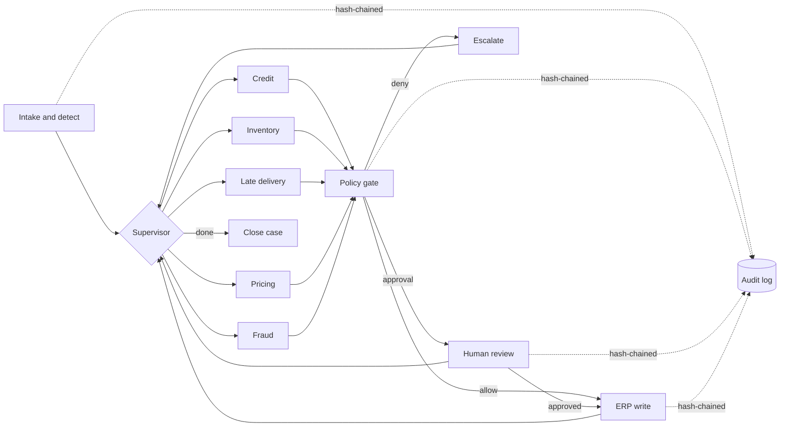

# Governed Multi-Agent Order Exception Handling: Reference Architecture

> A supervisor-and-specialist agent workflow that resolves order exceptions in an ERP. Agents propose actions, a policy gate decides, people approve where the policy requires it, and every step is audited and can be reversed.
> Runs offline with no API keys. Built on the public DataCo Smart Supply Chain schema.

## The problem (30 seconds)
In order-to-cash, a small share of order lines absorbs most of the manual effort: credit holds, stock shortfalls, at-risk deliveries, and pricing that doesn't match policy. These lines wait in shared queues, get worked inconsistently, and leak margin and revenue. The real challenge isn't building a clever agent. It's **letting agents act on the system of record without losing financial control.**

## What this pattern does
| Exception | Specialist | Possible actions | Approval needed when |
|---|---|---|---|
| Credit hold | Credit agent | Release hold / escalate to credit controller | Value > limit or overdue balance |
| Pricing mismatch | Pricing agent | Price-override *request* | **Always** (segregation of duties) |
| Inventory shortfall | Inventory agent | Split shipment / reschedule to next receipt | Value > limit or delay > 5 days |
| Late-delivery risk | Logistics agent | Upgrade shipping mode / re-promise date | Value > limit |
| Suspected fraud | Fraud router | Escalate only | Human-only; agents never write |

## Value framing: how outcomes would be measured
No results are claimed here. The demo runs on **synthetic** data. In a deployment, these KPIs would be baselined for 4–8 weeks before go-live and then tracked per exception type:

| Outcome | KPI | Source |
|---|---|---|
| Efficiency | Touchless resolution rate; exception cycle time (detect → resolve); manual touches per order | Audit log events and timestamps |
| Revenue protection | Value of orders released or recovered vs. baseline; on-time-in-full % | ERP order history, `value_at_stake` |
| Margin protection | Pricing leakage blocked (corrected − booked) | Pricing agent proposals plus approvals |
| Risk and control | Unauthorized writes (target: 0); policy-violation attempts; approval override rate; audit chain integrity | Policy and audit events |
| Trust and adoption | Approver acceptance rate per rule → evidence to widen the autonomy envelope | HITL events |

The demo already outputs the instrumentation for these KPIs (`out/summary.json`, `out/audit.jsonl`).

## Architecture at a glance

More detail: [component](docs/diagrams/component.md) · [sequence](docs/diagrams/sequence.md) · [state machine with HITL](docs/diagrams/state.md)

## Components
- **Intake and detector** (`agents.detect_exceptions`) classifies an open order line into prioritized exception types.
- **Supervisor** (`graph.supervisor`) works through the exception queue one item at a time and routes each to its specialist.
- **Specialists** (`agents.*Agent`) are read-only. They call ERP read tools and return a typed `Proposal` (action, params, rationale, confidence, value at stake).
- **ERP tool adapter** (`erp.MockERP`) provides read tools `read_order`, `check_credit`, `check_atp`, `list_price` and gated write tools `release_credit_hold`, `reschedule`, `split_shipment`, `upgrade_shipping`, `price_override_request`. Every write returns a snapshot for `rollback()`.
- **Policy gate** (`policy.evaluate`) holds versioned policy-as-code. It returns ALLOW, REQUIRE_APPROVAL, or DENY along with the ids of the rules that applied.
- **Human-in-the-loop** (`hitl.Approver`) routes approvals by role. The demo uses a deterministic simulated approver.
- **Audit log** (`audit.AuditLog`) is an append-only, SHA-256 hash-chained JSONL log with `verify()`.
- **LLM interface** (`llm.LLMClient`) is pluggable. The offline `RuleBasedLLM` stub only drafts rationale text and never authorizes anything.

## Key decisions
[ADR-0001 Supervisor graph](docs/adr/0001-supervisor-graph-orchestration.md) · [ADR-0002 Policy gate before writes](docs/adr/0002-policy-gate-before-writes.md) · [ADR-0003 HITL design](docs/adr/0003-hitl-approval-design.md) · [ADR-0004 Audit and rollback](docs/adr/0004-audit-and-rollback.md) · [ADR-0005 Deterministic core, pluggable LLM](docs/adr/0005-pluggable-llm-deterministic-core.md)

## Run it
```bash
make setup      # venv + langgraph + pytest
make demo       # processes open orders, writes out/summary.json and out/audit.jsonl
make demo-mini  # same workflow on the dependency-free graph runner
make test       # 17 pytest checks: policy, HITL, audit integrity, rollback, engine parity
```
To use the real DataCo file instead of the synthetic sample, see [docs/data.md](docs/data.md).

## Data
Source: **DataCo Smart Supply Chain for Big Data Analysis**, Kaggle, [`shashwatwork/dataco-smart-supply-chain-for-big-data-analysis`](https://www.kaggle.com/datasets/shashwatwork/dataco-smart-supply-chain-for-big-data-analysis). The committed sample is **synthetic** and follows the dataset's schema. Credit and stock figures are simulated. Details are in [docs/data.md](docs/data.md).

## Production readiness: what's here vs. what's next
✅ Typed contracts · policy-as-code with rule ids · write whitelist in the adapter · HITL routing · tamper-evident audit · rollback hook · engine-parity tests · deterministic CI
⏭ Durable checkpointing for async approvals · OpenTelemetry traces · real ERP adapters (OData/BAPI/REST) · eval harness (package 2) · shared governance control plane (package 3)

## Repository layout
```
src/oea/   models · data · erp · agents · policy · hitl · audit · llm · graph · demo
tests/     pytest suite
docs/      adr/ · diagrams/ · data.md
data/      sample/ (synthetic) · raw/ (gitignored, real Kaggle file)
scripts/   generate_sample.py
```
