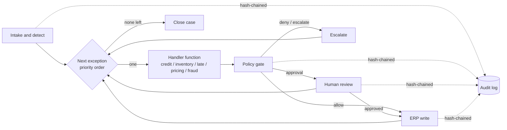

# Governed Order Exception Workflow: Reference Architecture

> A deterministic, governed workflow that resolves order exceptions in an ERP. Read-only handler functions propose actions, a policy gate decides, people approve where the policy requires it, and every step is audited and can be reversed.
> **No multi-agent supervisor, on purpose:** one workflow with modular handlers is cheaper, faster, and easier to govern and evaluate for this problem ([ADR-0006](docs/adr/0006-governed-workflow-over-multi-agent.md)).
> Runs offline with no API keys. Built on the public DataCo Smart Supply Chain schema.

## The problem (30 seconds)
In order-to-cash, a small share of order lines absorbs most of the manual effort: credit holds, stock shortfalls, at-risk deliveries, and pricing that doesn't match policy. These lines wait in shared queues, get worked inconsistently, and leak margin and revenue. The hard part isn't clever automation. It's **acting on the system of record without losing financial control.**

## Why a workflow, not agents
Most exceptions on an order line share the same context: one order, a few ERP lookups. Routing them through a supervisor and specialist agents adds model calls, hand-offs, and failure modes (bad routing, loops, disagreement) without better decisions. A fixed workflow gives the **same path and the same writes for the same input**, which is what auditors and regression evals need. ADR-0006 also lists the specific triggers (divergent context, open-ended planning, joint optimization, separate ownership, a measured eval gap) that would justify multi-agent later, and it would still sit inside the same policy gate.

| Choice | Effect |
|---|---|
| Static handler dispatch, not an LLM router | Zero routing errors; at most one optional model call per case instead of one per agent plus the router |
| Deterministic control flow | Audit replay and eval baselines are reproducible by construction |
| One write path behind the policy gate | One place to review, test, and certify |

## What the workflow does
Exceptions run in priority order: fraud > credit > pricing > inventory > logistics.

| Exception | Handler | Possible actions | Approval needed when |
|---|---|---|---|
| Suspected fraud | `handle_fraud` | Escalate only | Human-only; never writes |
| Credit hold | `handle_credit_hold` | Release hold / escalate to credit controller | Value > limit or overdue balance |
| Pricing mismatch | `handle_pricing_mismatch` | Price-override *request* | **Always** (segregation of duties) |
| Inventory shortfall | `handle_inventory_shortfall` | Split shipment / reschedule to next receipt | Value > limit or delay > 5 days |
| Late-delivery risk | `handle_late_delivery` | Upgrade shipping mode / re-promise date | Value > limit |

## Value framing: how outcomes would be measured
No results are claimed here. The demo runs on **synthetic** data. In a deployment, these KPIs would be baselined for 4–8 weeks before go-live and then tracked per exception type:

| Outcome | KPI | Source |
|---|---|---|
| Efficiency | Touchless resolution rate; exception cycle time (detect → resolve); manual touches per order | Audit log events and timestamps |
| Revenue protection | Value of orders released or recovered vs. baseline; on-time-in-full % | ERP order history, `value_at_stake` |
| Margin protection | Pricing leakage blocked (corrected − booked) | Pricing handler proposals plus approvals |
| Risk and control | Unauthorized writes (target: 0); policy-violation attempts; approval override rate; audit chain integrity | Policy and audit events |
| Trust and adoption | Approver acceptance rate per rule → evidence to widen the autonomy envelope | HITL events |

| Run cost and speed | Model calls per case; p95 latency per case. The workflow design keeps both low and predictable | Trace and audit timestamps |

The demo already outputs the instrumentation for these KPIs (`out/summary.json`, `out/audit.jsonl`).

## Architecture at a glance

More detail: [component](docs/diagrams/component.md) · [sequence](docs/diagrams/sequence.md) · [state machine with HITL](docs/diagrams/state.md)

## Components
- **Intake and detector** (`handlers.detect_exceptions`) classifies an open order line into a priority-ordered list of exception types.
- **Workflow** (`graph.build_workflow`) runs `intake → next_exception → handle → policy_gate → human_review | execute | escalate → … → finalize`. `next_exception` is a cursor, not a decision-maker.
- **Handler functions** (`handlers.HANDLERS`) are read-only. Each calls ERP read tools and returns a typed `Proposal` (action, params, rationale, confidence, value at stake), or `None` if the exception clears on check.
- **ERP tool adapter** (`erp.MockERP`) provides read tools `read_order`, `check_credit`, `check_atp`, `list_price` and gated write tools `release_credit_hold`, `reschedule`, `split_shipment`, `upgrade_shipping`, `price_override_request`. Every write returns a snapshot for `rollback()`.
- **Policy gate** (`policy.evaluate`) holds versioned policy-as-code. It returns ALLOW, REQUIRE_APPROVAL, or DENY along with the ids of the rules that applied.
- **Human-in-the-loop** (`hitl.Approver`) routes approvals by role. The demo uses a deterministic simulated approver.
- **Audit log** (`audit.AuditLog`) is an append-only, SHA-256 hash-chained JSONL log with `verify()`.
- **Optional LLM hook** (`llm.LLMClient`) is the single place a model can plug in, as one LLM with read-only tools for rationale or triage. The offline `RuleBasedLLM` stub drafts rationale text and never authorizes anything.
- **Engines.** LangGraph `StateGraph` is optional. The dependency-free `MiniGraph` runner is the fallback, and a parity test checks they give identical outcomes.

## Key decisions
[ADR-0006 Governed workflow over multi-agent](docs/adr/0006-governed-workflow-over-multi-agent.md) (supersedes [ADR-0001](docs/adr/0001-supervisor-graph-orchestration.md)) · [ADR-0002 Policy gate before writes](docs/adr/0002-policy-gate-before-writes.md) · [ADR-0003 HITL design](docs/adr/0003-hitl-approval-design.md) · [ADR-0004 Audit and rollback](docs/adr/0004-audit-and-rollback.md) · [ADR-0005 Deterministic core, pluggable LLM](docs/adr/0005-pluggable-llm-deterministic-core.md)

## Demo result (synthetic data, mechanics only)
107 open orders · 212 exception outcomes · 176 ERP writes, each after a policy decision · touchless rate 0.50 · 70 executed after approval · 16 escalated · audit chain valid. These are identical to the v0.1 multi-agent version: the simpler design changed none of the outcomes.

## Run it
`make` is optional; the plain commands are shown.
```bash
python -m venv .venv && .venv/bin/pip install -r requirements.txt
PYTHONPATH=src .venv/bin/python -m oea.demo                  # writes out/summary.json and out/audit.jsonl
PYTHONPATH=src .venv/bin/python -m oea.demo --no-langgraph   # same workflow on the dependency-free runner
PYTHONPATH=src .venv/bin/python -m pytest -q                 # 21 checks: policy, HITL, audit, rollback, workflow shape, determinism, engine parity
```
To use the real DataCo file instead of the synthetic sample, see [docs/data.md](docs/data.md).

## Version note
v0.2 replaced the v0.1 supervisor/specialist agents with this workflow. The eval harness ([order-exception-eval-harness](https://github.com/padmanpisupati/order-exception-eval-harness)) vendors and pins the **earlier v0.1 version at commit `68e5e44`**. Its scores still apply because the demo outcomes are identical, but its vendored code uses the old agent naming.

## Data
Source: **DataCo Smart Supply Chain for Big Data Analysis**, Kaggle, [`shashwatwork/dataco-smart-supply-chain-for-big-data-analysis`](https://www.kaggle.com/datasets/shashwatwork/dataco-smart-supply-chain-for-big-data-analysis). The committed sample is **synthetic** and follows the dataset's schema. Credit and stock figures are simulated. Details are in [docs/data.md](docs/data.md).

## Production readiness: what's here vs. what's next
✅ Deterministic workflow · typed contracts · policy-as-code with rule ids · write whitelist in the adapter · HITL routing · tamper-evident audit · rollback hook · engine-parity and determinism tests · deterministic CI
⏭ Durable checkpointing for async approvals · OpenTelemetry traces · real ERP adapters (OData/BAPI/REST) · parallel read-only context steps for slow lookups · see the eval harness (package 2) and the governance control plane (package 3)

## Repository layout
```
src/oea/   models · data · erp · handlers · policy · hitl · audit · llm · graph · demo
tests/     pytest suite
docs/      adr/ · diagrams/ · data.md
data/      sample/ (synthetic) · raw/ (gitignored, real Kaggle file)
scripts/   generate_sample.py
```
